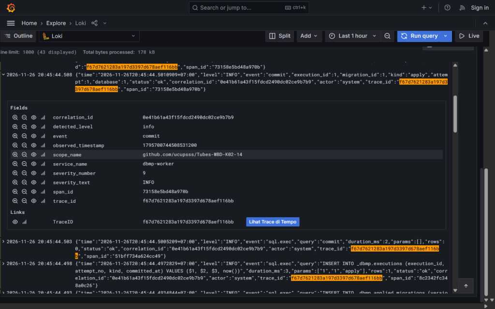
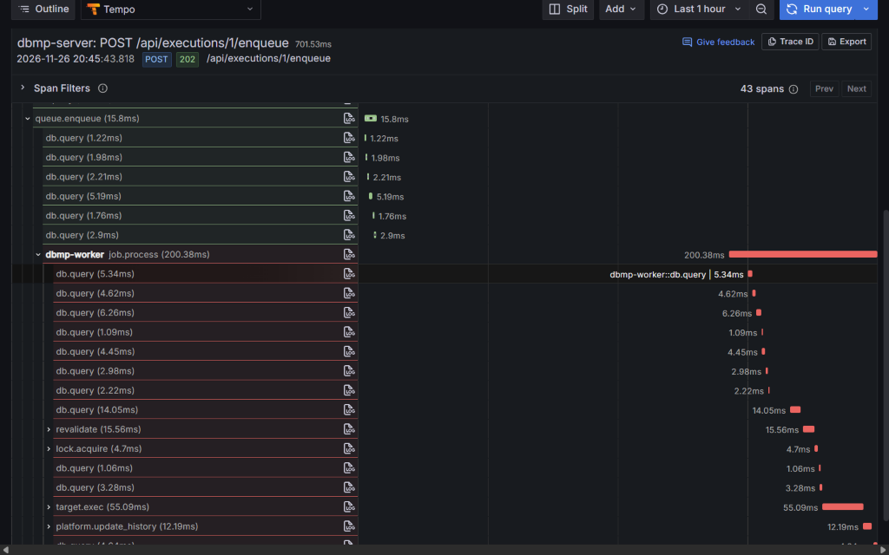
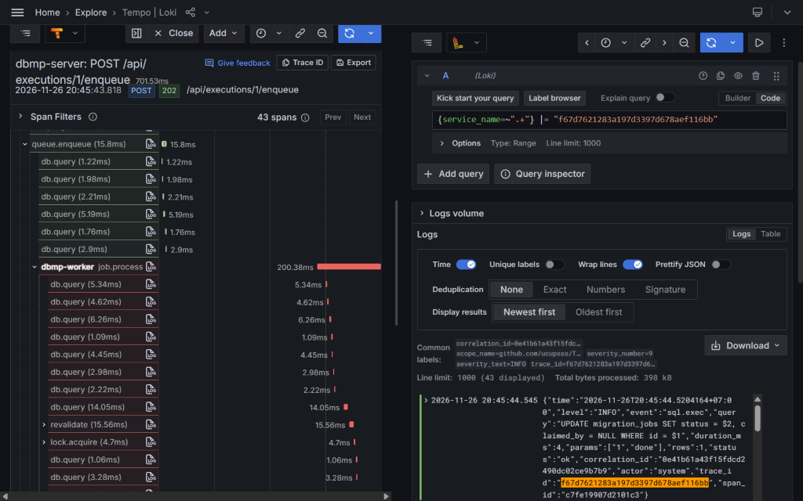

# Tubes WBD

Tubes WBD adalah platform manajemen database berbasis web untuk mengelola beberapa database PostgreSQL secara aman: login dan access control, menjelajahi schema dan data, lalu menyusun dan menjalankan migration di dalam transaction.

Backend ditulis dengan Go, dan halaman dirender di server memakai `html/template`. Pada milestone ini, database target yang didukung hanya PostgreSQL.

Alur minimum yang didukung:

```
Login → Access Control → Pilih Database → Lihat Schema/Data
      → Buat Migration → Jalankan → Commit/Rollback
      → Riwayat Migration diperbarui
```

## Menjalankan

Butuh Go 1.24+, Node.js 20+ (untuk frontend), Docker Desktop, dan `make` (Git Bash). Pastikan port di bawah tidak sedang dipakai Postgres lokal atau container lain.

```bash
cp .env.example .env
# isi APP_SECRET_KEY (openssl rand -base64 32) dan BOOTSTRAP_ADMIN_PASSWORD
make up
make web-install  # sekali saja: dependensi frontend
make web-build    # membangun SPA ke web/dist (di-embed ke binary Go)
make run          # API di http://localhost:8080
make worker       # proses terpisah yang mengambil job migration
make seed         # user, group, koneksi, dan grant untuk demo
make k6           # stress test API baca; butuh k6 dan server yang sudah jalan
```

Saat mengembangkan frontend, jalankan `make run` di satu terminal dan `make web-dev` di terminal lain, lalu buka `http://localhost:5173` (Vite meneruskan `/api` ke server Go, jadi tidak perlu CORS).

`make run` menjalankan migrasi platform secara otomatis. Jika ada file migrasi baru yang nomornya lebih kecil dari yang sudah diterapkan, jalankan `make db-reset`.

| Perintah                | Fungsi                                                                    |
|-------------------------|---------------------------------------------------------------------------|
| `make up` / `make down` | Menyalakan / mematikan Postgres                                           |
| `make db-reset`         | Menghapus volume lalu menyalakan ulang dari kosong                        |
| `make obs-up` / `make obs-down` | Menyalakan / mematikan stack Observability (OTel Collector, Tempo, Loki, Grafana) |
| `make worker`       | Worker antrian migration, proses terpisah dari API                        |
| `make k6`           | Stress test k6 pada API baca. Butuh [k6](https://grafana.com/docs/k6/) di PATH |
| `make web-check`        | Frontend: type-check, unit test, dan build                                |
| `make test`             | Unit test                                                                 |
| `make test-integration` | Unit test + integration test (butuh `make up` dan `TEST_DATABASE_URL`)    |
| `make check`            | `lint` + integration test. Wajib lolos sebelum membuka PR                 |

Port lokal: aplikasi `8080`, platform-db `5432`, target-db-1 `5433`, target-db-2 `5434`, test-db `5440`.

## Akun demo

Saat `make run` pertama kali dan tabel user masih kosong, admin dibuat dari `BOOTSTRAP_ADMIN_USERNAME` / `BOOTSTRAP_ADMIN_PASSWORD`.

`make seed` menambahkan:

| User  | Password      | Group              |
|-------|---------------|--------------------|
| alice | `password123` | dev                |
| bob   | `password123` | dev dan analyst    |
| carol | `password123` | analyst            |

Koneksi `target-db-1` (port 5433, database `target1`) dan `target-db-2` (port 5434, database `target2`) memakai user/password `target`. Grant: `dev` punya akses edit ke db1; `analyst` punya akses view ke db1 dan db2. Bob ada di kedua group, sehingga akses efektif Bob ke db1 adalah edit.

Password koneksi target di seed hanya untuk demo lokal.

## Keputusan desain

| #   | Keputusan |
|-----|-----------|
| D1  | Akses efektif adalah level **tertinggi** dari semua group user pada database tersebut (`edit` > `view` > tidak ada). |
| D2  | Platform Admin **tidak** otomatis punya akses ke database target. Admin hanya mengelola user, group, koneksi, dan grant; untuk membuka database, admin harus menjadi anggota group yang punya grant. |
| D3  | Session: idle timeout 30 menit, absolute expiration 8 jam, rotasi tiap 15 menit, grace period 30 detik. Semuanya bisa diubah lewat env. Waktu aktivitas terakhir (`last_seen_at`) diperbarui paling sering sekali per menit, jadi idle timeout berpresisi ±1 menit. |
| D4  | Session identifier adalah 32 byte acak (`crypto/rand`). Database hanya menyimpan hash SHA-256-nya. |
| D5  | Token lama yang dikirim selama grace period tetap dilayani, dan tidak dirotasi lagi. Setelah grace period habis, token lama ditolak. |
| D6  | Kenaikan privilege (dijadikan admin, masuk group, atau grant naik) menaikkan `privilege_version`, sehingga session dirotasi pada request berikutnya. |
| D7  | Menonaktifkan user, mencabut status admin, atau reset password oleh admin mencabut semua session user tersebut. Keluar dari group atau kehilangan grant langsung berlaku karena hak akses dibaca ulang dari database di setiap request. |
| D8  | User tidak pernah dihapus permanen. Penonaktifan mengisi `is_active = false`. Admin tidak bisa mencabut status admin atau menonaktifkan akunnya sendiri. |
| D9  | Koneksi yang sudah punya riwayat migration tidak bisa dihapus (`ON DELETE RESTRICT`). |
| D10 | Nomor versi diberikan saat eksekusi berhasil: `max(version) + 1` per database. Draft dan migration gagal belum punya versi. Setiap percobaan dicatat di `migration_runs`. (M1; di M2 riwayat ada di `executions` dan `execution_attempts`, lihat D24 dan D29.) |
| D11 | Migration `success` tidak bisa diubah, dihapus, atau dijalankan ulang. Draft bisa diubah, dihapus, dan dijalankan. Migration `failed` bisa diubah dan dijalankan ulang, tetapi tidak bisa dihapus. (M1; di M2 digantikan D29 dan D30.) |
| D12 | Eksekusi untuk satu database diserialisasi dengan `SELECT ... FOR UPDATE` pada baris `db_connections`. (M1; di M2 digantikan lock berlease D34.) |
| D13 | SQL yang berisi `BEGIN` / `COMMIT` / `ROLLBACK` / `SAVEPOINT`, `CREATE INDEX CONCURRENTLY`, `VACUUM`, atau `CREATE DATABASE` ditolak. Kata yang sama di dalam string atau komentar tetap diperbolehkan. |
| D14 | Database explorer hanya membaca: memakai transaction `READ ONLY`, `statement_timeout`, identifier yang di-quote, dan data berpaginasi. |
| D15 | Request tanpa login diarahkan ke `/login`. User yang sudah login tetapi tidak berhak mendapat 403, termasuk untuk ID database yang tidak ada (supaya keberadaan database tidak bocor). Target database yang tidak bisa dihubungi menghasilkan 502 dengan pesan tanpa password/DSN. |
| D16 | Username 3–32 karakter (huruf, angka, `.`, `_`, `-`). Password minimal 8 karakter dan maksimal 72 byte (batas bcrypt; byte sesudahnya ditolak, bukan dipotong diam-diam). |
| D17 | Satu user boleh punya beberapa session sekaligus (mis. dua perangkat). Login ulang di browser yang sama mencabut session lama di browser itu. |
| D18 | Menghapus group ikut menghapus keanggotaan dan grant group tersebut (`ON DELETE CASCADE`). |
| D19 | Explorer menampilkan semua schema kecuali `pg_catalog`, `information_schema`, dan `_dbmp` (tabel internal platform). Data ditampilkan 50 baris per halaman (maksimal 200) dan diurutkan berdasarkan primary key bila ada. |
| D20 | Analisis EXPLAIN hanya untuk migration `draft` atau `failed` dan butuh akses edit, karena `EXPLAIN ANALYZE` benar-benar mengeksekusi statement. Detailnya ada di bagian [Analisis EXPLAIN](#analisis-explain). |
| D21 | Frontend adalah Single-Page Application: React 18 + Vite + TypeScript + React Router + TanStack Query, folder `frontend/`. Hasil build ada di `web/dist` dan disajikan server Go (`internal/spa`). Path yang bukan route server dan bukan file dijawab `index.html` supaya router SPA menanganinya; file ber-ekstensi yang tidak ada tetap 404 (HTML tidak menyamar sebagai JS/CSS). |
| D22 | API berformat JSON di bawah `/api`, memakai cookie session yang sama. Mutasi wajib membawa header `X-CSRF-Token`: token session dari `GET /api/me`, atau token pre-login dari `GET /api/csrf` (double-submit cookie). Error berbentuk `{"error":{"code","message","details"}}`; request tanpa login ke `/api` dijawab 401 JSON, bukan redirect. |
| D23 | Queue berupa tabel `migration_jobs` di database platform (tanpa broker terpisah, diizinkan Q&A). Worker adalah proses terpisah (`cmd/worker`) yang mengambil job dengan `FOR UPDATE SKIP LOCKED`; akses lewat interface `queue.Queue` sehingga bisa diganti broker. Job bertahan setelah restart karena tersimpan di database. |
| D24 | Model: `migration` (identitas) → `migration_revisions` (SQL up/down, immutable setelah diajukan) → `executions` (satu permintaan dan hasilnya, satu baris riwayat) → `execution_attempts` (satu percobaan teknis, termasuk retry) → `execution_batches` (cermin checkpoint mode batch). Data `migrations`/`migration_runs` M1 dipindahkan ke model ini oleh migration 0400. |
| D25 | Jenis execution: `apply` (pertama kali), `forward` (menjalankan ulang up setelah rollback atau gagal), dan `rollback` (menjalankan down, termasuk revert batch). Resume bukan jenis baru. |
| D26 | Status execution: `pending_review` → `approved` → `queued` → `running` → `success`/`failed`, ditambah `partial`, `partially_reverted`, `uncertain`, `rejected`, dan `cancelled`. "Draft" adalah keadaan migration yang belum punya execution. |
| D27 | Setiap perubahan database (apply, forward, rollback) butuh approval dari leader **setiap** group yang punya grant view atau edit ke database tersebut. Satu baris approval per (execution, ronde, group). Satu **reject** menolak seluruh execution. |
| D28 | Leader group (`groups.leader_id`) harus anggota aktif group. Leader tidak bisa dikeluarkan dari group atau dinonaktifkan sebelum diganti. Leader boleh meng-approve perubahan yang ia ajukan sendiri, dan satu keputusan mewakili semua group yang ia pimpin. Group tanpa leader **tidak menolak** pengajuan: execution tetap menunggu sampai leader ditetapkan. Platform Admin tidak otomatis boleh approve (konsisten dengan D2). |
| D29 | Rantai aktif linear: `version` diberikan saat apply/forward sukses (`max(version) + 1` per database) dan dikosongkan saat rollback sukses. Rollback hanya untuk migration teratas (`409 not_top_of_chain`); forward hanya untuk migration yang tidak aktif dan tidak menjalankan migration lain. Rollback yang gagal tidak mengubah posisi aktif. |
| D30 | Immutability: SQL revisi tidak bisa diubah setelah diajukan, termasuk bila eksekusinya gagal. Mengubah migration yang sudah diajukan membuat revisi baru yang perlu review ulang. Rollback selalu memakai SQL down revisi yang benar-benar dijalankan, dan worker menolak bila hash SQL berbeda dengan yang disetujui. |
| D31 | Migration irreversible wajib menyertakan alasan, tidak punya SQL down, dan ditolak oleh rollback maupun revert batch. |
| D32 | Semua attempt (sukses, gagal, retry) tercatat di `execution_attempts` dengan salinan SQL yang benar-benar dijalankan, SQLSTATE, waktu, dan `trace_id`, serta di log aplikasi. Catatan tidak pernah ditimpa. Rollback menyimpan `rolls_back_execution_id`. |
| D33 | Filter **Hide rollback** di riwayat eksekusi menyembunyikan pasangan `(execution yang dibatalkan, rollback sukses yang membatalkannya)` berdasarkan **Execution ID** (`rolls_back_execution_id`), bukan nama migration. Eksekusi gagal dan rollback gagal selalu tetap tampil. Filter hanya mengubah tampilan dan tidak menghapus data. |
| D34 | Lock per database di tabel `database_locks` dengan lease 30 detik yang diperpanjang tiap 10 detik. Satu database hanya menjalankan satu execution; database berbeda boleh paralel. Lock dipegang sepanjang semua batch. Lease yang kedaluwarsa boleh diambil alih worker lain hanya setelah memeriksa bukti eksekusi (D37). |
| D35 | Retry otomatis hanya untuk kegagalan sementara (SQLSTATE kelas `08`, `40001`, `40P01`, `57P01`, `53300`, serta `55P03` lock timeout, mis. karena transaksi yatim worker yang mati masih memegang lock), paling banyak 3 attempt dengan jeda 5 lalu 15 detik. Kesalahan SQL lain langsung gagal. Retry tidak membuka ronde approval baru. |
| D36 | **Resume dan revert batch**: resume melanjutkan Execution ID yang sama dari checkpoint terakhir di `_dbmp.batch_checkpoints` tanpa mengulang batch yang sudah committed dan memakai approval yang sudah ada. Rollback pada eksekusi batch yang sudah committed (atau `partial`) menjalankan SQL down per batch yang sudah committed dalam **urutan terbalik** (`batch_no` terbesar ke terkecil). Bila revert gagal di tengah, status menjadi `partially_reverted` dan dapat di-resume dengan aturan yang sama. |
| D37 | **Bukti eksekusi** disimpan di database target dalam transaction yang sama dengan perubahan: `_dbmp.executions` (mode biasa) dan `_dbmp.batch_checkpoints` (mode batch). Tabel `execution_batches` di database platform merupakan cermin untuk tampilan UI. |
| D38 | Selama sebuah database punya execution `running`, `partial`, `partially_reverted`, atau `uncertain`, execution lain di database itu tidak boleh mulai. Pengecualiannya resume execution itu sendiri dan revert batch yang membatalkannya; partial yang sudah di-revert sukses tidak lagi menahan. |
| D39 | **Mode batch**: migration mendefinisikan `batch_table`, `batch_column` (wajib bertipe integer di katalog target), dan `batch_size`. SQL up dan down wajib memuat placeholder `:from` (batas bawah eksklusif) dan `:to` (batas atas inklusif). Platform mencari batas atas tiap batch lewat query berbatas `LIMIT`, lalu mengganti `:from` dan `:to` dengan angka literal `int64` tanpa memuat seluruh dataset ke memori. |
| D40 | Approval dicek ulang dari grant dan leader **saat ini** sebelum job berjalan. Bila ada group baru yang punya akses atau leader berganti, approval dicabut dan execution kembali ke `pending_review` pada ronde berikutnya (bukan `failed`). Approval tidak perlu diulang untuk retry otomatis dan resume dari checkpoint. |
| D41 | Audit log berupa event log terstruktur `audit.*` ke stdout, tidak disimpan di database platform. Riwayat migration di database tidak terpengaruh filter tampilan apa pun. |
| D42 | Data uji besar dibuat dengan script (`cmd/dataset`, `generate_series`): tabel `big_events` 400.000 baris, cukup untuk satu `UPDATE` tanpa batch > 1 detik. Hasil pengukuran ada di bagian Dataset besar. |

### Kode status di halaman error

Halaman error menampilkan kode status, namanya, dan penjelasan singkat.

| Kode | Nama | Kapan muncul |
|------|------|--------------|
| — (redirect ke `/login`) | Belum login | Membuka halaman terproteksi tanpa session yang berlaku (belum login, session idle/absolute habis, atau sudah dicabut). |
| 400 | Permintaan Tidak Valid | Format permintaan salah. Kesalahan isian form ditampilkan langsung di form (422). |
| 401 | — | Login gagal; form login ditampilkan lagi dengan pesan generik. |
| 403 | Akses Ditolak | Sudah login tetapi tidak berhak (bukan admin, akses database kurang), atau token CSRF tidak valid. |
| 404 | Tidak Ditemukan | Halaman, table, atau migration tidak ada (termasuk alamat URL yang salah ketik). |
| 409 | Konflik | Aksi bertentangan dengan kondisi data, mis. nama sudah dipakai, migration `success` diubah, atau koneksi yang punya riwayat migration dihapus. |
| 502 | Database Tidak Dapat Dihubungi | Database target mati atau menolak koneksi. |
| 500 | Kesalahan Server | Kesalahan tak terduga; detailnya hanya dicatat di log server. |

### Parameter session

| Env                         | Default | Arti |
|-----------------------------|---------|------|
| `SESSION_IDLE_TIMEOUT`      | `30m`   | Session berakhir bila tidak ada request selama waktu ini. |
| `SESSION_ABSOLUTE_TIMEOUT`  | `8h`    | Umur maksimum session sejak login. Tidak diperpanjang oleh aktivitas maupun rotasi. |
| `SESSION_ROTATION_INTERVAL` | `15m`   | Session identifier diganti secara berkala (selain saat login dan saat privilege naik). |
| `SESSION_GRACE_PERIOD`      | `30s`   | Identifier lama masih diterima sebentar setelah rotasi, untuk request yang berjalan bersamaan. |

Cookie session: `dbmp_session` (`HttpOnly`, `SameSite=Lax`, `Secure` bila `APP_ENV=production`, tanpa `Expires`). Nama cookie tetap; nilainya diganti setiap rotasi. Logout (`POST /logout`) menonaktifkan session di backend, bukan hanya menghapus cookie.

Password di-hash dengan bcrypt (cost 12). Login yang gagal selalu memberi pesan yang sama. Password, session identifier, dan token CSRF tidak pernah muncul di URL, response, maupun log; logger hanya mencatat method, path, status, dan durasi.

### CSRF

Semua `POST/PUT/PATCH/DELETE` wajib membawa token, lewat hidden field `_csrf` atau header `X-CSRF-Token`. Token yang kosong atau salah menghasilkan 403.

- Setelah login, token berasal dari session (`sessions.csrf_token`) dan dibandingkan secara constant-time.
- Form login (belum ada session) memakai cookie double-submit `dbmp_csrf_pre`, ditambah pengecekan bahwa header `Origin`/`Referer` berasal dari host yang sama.

### Matriks hak akses

Aturan aksi hanya didefinisikan di satu tempat: `internal/authz/policy.go`. Aksi yang tidak terdaftar selalu ditolak. Route `/db/...` mengikuti grant group.

| Route                                                   | Akses minimum    |
|---------------------------------------------------------|------------------|
| `GET/POST /login`                                       | publik           |
| `POST /logout`, `GET /` (dashboard)                     | login            |
| `/admin/users`, `/admin/groups`                         | platform admin   |
| `/admin/databases`, `/admin/groups/{id}/access`         | platform admin   |
| `GET /db/{dbID}/...` (schema dan data)                  | view             |
| `GET /db/{dbID}/migrations`, `GET .../{id}`             | view             |
| buat, ubah, jalankan, hapus draft migration             | edit             |
| analisis EXPLAIN (`POST .../migrations/{id}/explain`)   | edit             |

Menyembunyikan tombol di antarmuka bukan otorisasi; setiap aksi dicek ulang di backend.

## Frontend (SPA) dan API

Seluruh halaman login, administrasi (user, group, leader, akses database, koneksi database), inbox approval, dashboard, **database explorer** (katalog skema, struktur tabel, data baris berpaginasi, analisis EXPLAIN), **definisi migration** (daftar, editor SQL up/down, irreversible beserta alasan, mode normal atau batch dengan konfigurasinya, detail dengan alur status dan keputusan leader per group, tombol Submit for review), serta **eksekusi & riwayat migration** (monitor job asinkron, filter Hide rollback, detail execution, attempt, dan checkpoint batch) disajikan sebagai SPA.

- **Responsif**: navigasi menjadi menu hamburger di layar sempit, tabel menjadi kartu bertumpuk di mobile, tabel data lebar (`.data-grid-wrap`) scroll horizontal di dalam komponennya (bukan di halaman), dan semua kontrol berukuran minimal 44 px. Diuji pada lebar 360 px dan 1280 px.
- **Satu pintu ke backend**: semua request lewat `apiFetch` (`frontend/src/api/client.ts`) yang memasang token CSRF, menyeragamkan error, dan mengosongkan sesi saat server menjawab 401.
- **Format error API**:

| HTTP | `code`                         | Arti |
|------|--------------------------------|------|
| 400  | `invalid`                      | Input tidak valid; `details.fields` berisi pesan per field |
| 401  | `unauthenticated`, `invalid_credentials` | Belum login atau session habis; kredensial salah (pesan sengaja generik) |
| 403  | `forbidden`                    | Tidak berhak, termasuk token CSRF salah dan ID database yang tidak ada (D15) |
| 404  | `not_found`                    | Data atau path tidak ada |
| 409  | `conflict`                     | Bentrok aturan; `details.reason` berisi kode mesin (mis. `is_leader`, `leader_not_member`, `not_analyzable`) |
| 502  | `target_unavailable`           | Database target tidak dapat dihubungi |
| 500  | `internal`                     | Kesalahan server; detail hanya ada di log, tidak pernah di respons |

- **Endpoint** (semua JSON): `GET /api/csrf`, `POST /api/auth/login`, `POST /api/auth/logout`, `GET /api/me`; `GET|POST /api/admin/users`, `GET|PUT /api/admin/users/{id}`, `POST /api/admin/users/{id}/password`; `GET|POST /api/admin/groups`, `GET|PUT|DELETE /api/admin/groups/{id}`, `POST /api/admin/groups/{id}/members`, `DELETE /api/admin/groups/{id}/members/{userID}`, `PUT /api/admin/groups/{id}/leader`, `GET|PUT /api/admin/groups/{id}/access`; `GET|POST /api/admin/databases`, `GET|PUT|DELETE /api/admin/databases/{id}`, `POST /api/admin/databases/test`, `POST /api/admin/databases/{id}/test`; `GET /api/approvals`, `POST /api/executions/{id}/approve|reject`; `GET /api/databases`, `GET /api/databases/{dbID}/schema`, `GET /api/databases/{dbID}/tables/{schema}/{table}`, `GET /api/databases/{dbID}/tables/{schema}/{table}/data?page=&page_size=`; `POST /api/databases/{dbID}/migrations/{id}/explain`.

## Approval dan leader

Leader ditetapkan Platform Admin di halaman detail group. Saat sebuah execution diajukan, sistem membuat satu baris approval untuk tiap group yang punya akses ke database itu. Leader melihat antreannya di menu **Approval** (`GET /api/approvals`) dan memutuskan lewat `POST /api/executions/{id}/approve|reject`. Execution baru bisa lanjut ke antrean setelah semua group menyetujui; pengguna yang mengajukan lalu menekan tombol Jalankan (tidak otomatis).

Paket `internal/approval` tidak mengubah status execution sendiri: ia memanggil interface `Executions` yang diimplementasikan modul execution, dan menyediakan `OpenRound`, `Verify`, dan `Revoke` untuk worker (revalidasi, D40).

## Log terstruktur

Seluruh log aplikasi berupa satu baris JSON ke stdout (`internal/logx`). Pesan menjadi field `event`; `correlation_id` dibaca dari header `X-Correlation-Id` (bila valid) atau dibuat server, dikirim balik di header respons, dan ikut di semua log request; `actor` terisi setelah session dikenali. Nilai sensitif (password, token, session, cookie, CSRF, DSN) diganti `[REDACTED]`, dan nilai string dipotong 256 karakter. Contoh keluaran nyata:

```json
{"time":"2026-11-17T18:56:17.5052763+07:00","level":"INFO","event":"auth.login","user_id":1,"status":"ok","correlation_id":"demo-corr-1"}
{"time":"2026-11-17T18:56:17.5968612+07:00","level":"INFO","event":"http.request","method":"GET","path":"/api/me","status":200,"duration_ms":4,"correlation_id":"f254b3df5b4051ea16b24520ecbec15b","actor":"admin"}
```

Helper `logx.SQL` mencatat satu eksekusi SQL (query, parameter yang disamarkan, durasi, jumlah row, SQLSTATE), dan `logx.Audit` mencatat event `audit.*`. Atribut `trace_id` dan `span_id` terisi otomatis begitu paket tracing mendaftarkan pembacanya lewat `logx.SetTraceExtractor`.

## Distributed Tracing (OpenTelemetry) dan Korelasi Log

Paket `internal/telemetry` menginisialisasi OpenTelemetry SDK (exporter stdout/console, propagator W3C `TraceContext`), HTTP middleware, fungsi propagasi queue (`telemetry.Inject` dan `telemetry.Extract`), serta `telemetry.PgxTracer()` (`pgx.QueryTracer` & `pgx.BatchTracer`) yang dipasang di seluruh pool database platform maupun target.

Alur span dan korelasi log:
1. Request masuk melewati `CorrelationMiddleware` lalu `telemetry.HTTPMiddleware` yang membuka root span HTTP (`POST /api/executions/{id}/enqueue`).
2. Handler enqueue membuka span `queue.enqueue`; dari dalam span itu `telemetry.Inject(ctx)` menyimpan `traceparent` dan `correlation_id` ke `migration_jobs.trace_context`.
3. Worker memulihkan trace context dengan `telemetry.Extract(ctx, carrier)`, sehingga `job.process` menjadi anak `queue.enqueue`. Di bawahnya ada `revalidate`, `lock.acquire`, `target.exec` (mode normal) atau satu `target.batch` per batch, lalu `platform.update_history` saat hasil dicatat di database platform.
4. `PgxTracer()` membuat span `db.query` untuk setiap statement dan memanggil `logx.SQL`, sehingga setiap baris log SQL mencantumkan `trace_id`, `span_id`, `correlation_id`, `execution_id`, `batch_no`, durasi, jumlah row, serta `sqlstate` bila gagal.
5. Span yang gagal diberi status `Error` beserta event error lewat `telemetry.End`; pesan error disamarkan dulu dengan `logx.RedactString`.
6. Commit dan rollback transaction target dicatat sebagai event tersendiri (`commit`, `rollback`), di mode normal maupun per batch.

Contoh keluaran nyata, diambil dari `make run` dan `make worker` saat menjalankan migration batch `UPDATE big_events SET payload = payload + 1 WHERE id > :from AND id <= :to` (ukuran batch 200.000) pada 400.000 baris. Semua baris berasal dari satu trace `6a7492cade455ce71b81ab798e50ac54`; satu-satunya suntingan adalah `worker_id` (nama host) yang diganti `<hostname>`.

Log JSON (server lalu worker):

```json
{"time":"2026-11-25T17:45:02.2377452+07:00","level":"INFO","event":"audit.enqueue","execution_id":2,"job_id":1,"database":1,"correlation_id":"demo-readme-1","actor":"alice","trace_id":"6a7492cade455ce71b81ab798e50ac54","span_id":"ad59c823df958056"}
{"time":"2026-11-25T17:45:02.2377452+07:00","level":"INFO","event":"http.request","method":"POST","path":"/api/executions/2/enqueue","status":202,"duration_ms":16,"correlation_id":"demo-readme-1","actor":"alice","trace_id":"6a7492cade455ce71b81ab798e50ac54","span_id":"93f7d41887d27daf"}
{"time":"2026-11-25T17:45:02.4052615+07:00","level":"INFO","event":"job.claimed","job_id":1,"execution_id":2,"attempt":1,"worker_id":"<hostname>","correlation_id":"demo-readme-1","actor":"system","trace_id":"6a7492cade455ce71b81ab798e50ac54","span_id":"a286d806ff6686ea"}
{"time":"2026-11-25T17:45:02.4766586+07:00","level":"INFO","event":"audit.start","execution_id":2,"database":1,"kind":"apply","exec_mode":"batch","correlation_id":"demo-readme-1","actor":"system","trace_id":"6a7492cade455ce71b81ab798e50ac54","span_id":"a286d806ff6686ea"}
{"time":"2026-11-25T17:45:03.143643+07:00","level":"INFO","event":"sql.exec","query":"UPDATE big_events SET payload = payload + 1 WHERE id > 0 AND id <= 200000","duration_ms":594,"params":["simple protocol"],"rows":200000,"status":"ok","migration_id":2,"execution_id":2,"job_id":1,"attempt":1,"batch_no":1,"correlation_id":"demo-readme-1","actor":"system","trace_id":"6a7492cade455ce71b81ab798e50ac54","span_id":"4e35ca6e9d94782c"}
{"time":"2026-11-25T17:45:03.1506275+07:00","level":"INFO","event":"batch.committed","execution_id":2,"direction":"apply","batch_no":1,"from":0,"to":200000,"rows":200000,"status":"ok","correlation_id":"demo-readme-1","actor":"system","trace_id":"6a7492cade455ce71b81ab798e50ac54","span_id":"fa67929109f40f39"}
{"time":"2026-11-25T17:45:03.1506275+07:00","level":"INFO","event":"commit","execution_id":2,"batch_no":1,"direction":"apply","status":"ok","correlation_id":"demo-readme-1","actor":"system","trace_id":"6a7492cade455ce71b81ab798e50ac54","span_id":"fa67929109f40f39"}
{"time":"2026-11-25T17:45:03.7791403+07:00","level":"INFO","event":"batch.committed","execution_id":2,"direction":"apply","batch_no":2,"from":200000,"to":400000,"rows":200000,"status":"ok","correlation_id":"demo-readme-1","actor":"system","trace_id":"6a7492cade455ce71b81ab798e50ac54","span_id":"8554b13610bcdf7c"}
{"time":"2026-11-25T17:45:03.7791403+07:00","level":"INFO","event":"commit","execution_id":2,"batch_no":2,"direction":"apply","status":"ok","correlation_id":"demo-readme-1","actor":"system","trace_id":"6a7492cade455ce71b81ab798e50ac54","span_id":"8554b13610bcdf7c"}
{"time":"2026-11-25T17:45:03.8216258+07:00","level":"INFO","event":"audit.finish","execution_id":2,"database":1,"migration_id":2,"correlation_id":"demo-readme-1","actor":"system","trace_id":"6a7492cade455ce71b81ab798e50ac54","span_id":"211312528ca08252"}
```

Pohon span pada trace yang sama (durasi dihitung dari `StartTime`/`EndTime` exporter console; span `db.query` di bawah tiap node tidak ditampilkan):

```text
POST /api/executions/2/enqueue    93f7d41887d27daf   17 ms   (server)
└─ queue.enqueue                  ad59c823df958056   11 ms
   └─ job.process                 a286d806ff6686ea 1438 ms   (worker)
      ├─ revalidate               651991dd99bbcd78   11 ms
      ├─ lock.acquire             ff1cd1818527fa2a    5 ms
      ├─ target.batch  #1         fa67929109f40f39  622 ms   200.000 baris
      ├─ target.batch  #2         8554b13610bcdf7c  621 ms   200.000 baris
      ├─ target.batch  #3         10c8f85c7c420804    1 ms   cursor habis, tidak ada batch
      └─ platform.update_history  211312528ca08252    9 ms
```

Span `target.batch` batch 1 apa adanya dari exporter console (field yang tidak relevan seperti `Resource` dan `InstrumentationScope` dihilangkan):

```json
{"Name": "target.batch", "SpanContext": {"TraceID": "6a7492cade455ce71b81ab798e50ac54", "SpanID": "fa67929109f40f39", "TraceFlags": "01", "TraceState": "", "Remote": false}, "Parent": {"TraceID": "6a7492cade455ce71b81ab798e50ac54", "SpanID": "a286d806ff6686ea", "TraceFlags": "01", "TraceState": "", "Remote": false}, "StartTime": "2026-11-25T17:45:02.528999+07:00", "EndTime": "2026-11-25T17:45:03.1506275+07:00", "Attributes": [{"Key": "execution_id", "Value": {"Type": "INT64", "Value": 2}}, {"Key": "batch.direction", "Value": {"Type": "STRING", "Value": "apply"}}, {"Key": "batch.no", "Value": {"Type": "INT64", "Value": 1}}, {"Key": "batch.from", "Value": {"Type": "INT64", "Value": 0}}, {"Key": "batch.to", "Value": {"Type": "INT64", "Value": 200000}}, {"Key": "batch.rows_affected", "Value": {"Type": "INT64", "Value": 200000}}], "Status": {"Code": "Unset", "Description": ""}}
```

Contoh kegagalan dan redaksi ditunjukkan oleh test: `TestTracing_FailedStatementLogsRollbackAndMarksSpan` (event `rollback` dengan `sqlstate` 22012 dan span `target.exec` berstatus `Error`) dan `TestTelemetryEnd_RecordsRedactedError` (credential dalam pesan error tidak masuk ke span).

### Stack Observability: OpenTelemetry Collector, Tempo, Loki, dan Korelasi Log-Trace

Untuk menjalankan backend penerima trace dan log beserta korelasi dua arahnya di Grafana (`deploy/observability/`):

```bash
make obs-up
export OTEL_EXPORTER_OTLP_ENDPOINT=http://localhost:4318
make run     # terminal 1
make worker  # terminal 2
```

- **Satu jalur melalui OpenTelemetry Collector** (`:4317` gRPC, `:4318` HTTP): API server (`dbmp-server`) dan worker (`dbmp-worker`) mengirim trace memakai exporter resmi `otlptracehttp` (`/v1/traces`) dan log JSON terstruktur lewat OTLP/HTTP (`/v1/logs`) ke Collector. Collector meneruskan trace ke **Grafana Tempo** (`:3200`) dan log ke **Grafana Loki** (`:3100/otlp`) sehingga tidak ada log ganda dan seluruh telemetri melalui Collector.
- **Pembatasan kardinalitas label**: satu-satunya indexed label stream di Loki adalah `service_name` (`dbmp-server` / `dbmp-worker`). Nilai dengan kardinalitas tinggi seperti `user_id`, `job_id`, `execution_id`, `trace_id`, atau teks `SQL` disimpan di dalam body JSON / structured metadata, bukan sebagai label indeks.
- **Korelasi Log ↔ Trace di Grafana** (`http://localhost:3000`): datasource Loki dikonfigurasi dengan *Derived Field* `TraceID` (`"trace_id":"([a-f0-9]{32})"`) yang menautkan langsung baris log ke waterfall span di Tempo, dan datasource Tempo memiliki *Traces to Logs* (`{service_name=~".+"} |= "$${__span.traceId}"`) yang memfilter log di Loki berdasarkan `trace_id` yang sama.

Contoh hasil nyata korelasi log dan trace di Grafana untuk trace `f67d7621283a197d3397d678aef116bb` (satu alur penuh `POST /api/executions/1/enqueue` hingga worker selesai):

1. **Log di Loki dengan tautan ke trace Tempo (`Lihat Trace di Tempo`)**:
   
2. **Waterfall trace di Tempo dari API server (`POST /api/executions/1/enqueue` → `queue.enqueue`) sampai worker (`job.process` → `revalidate`, `lock.acquire`, `target.exec`, `platform.update_history`, `db.query`)**:
   
3. **Korelasi Trace → Logs (split view Tempo | Loki dengan query `{service_name=~".+"} |= "f67d7621283a197d3397d678aef116bb"`)**:
   

## Mode Eksekusi per Batch (`internal/batch`)

Untuk perubahan data berukuran besar, migration dapat dijalankan dalam mode `batch` (`exec_mode = 'batch'`) agar tidak menahan lock tabel dalam satu transaksi raksasa:

- **Konvensi placeholder `:from` dan `:to` (D39)**:
  - Migration mendefinisikan `batch_table` (mis. `big_events`), `batch_column` (kolom integer unik dan tidak berubah selama migrasi, mis. `id`), dan `batch_size` (> 0).
  - `up_sql` dan `down_sql` wajib memuat placeholder `:from` (batas bawah **eksklusif**, `> :from`) dan `:to` (batas atas **inklusif**, `<= :to`), misalnya:
    ```sql
    -- SQL Up:
    UPDATE big_events SET payload = payload + 1 WHERE id > :from AND id <= :to;
    -- SQL Down:
    UPDATE big_events SET payload = payload - 1 WHERE id > :from AND id <= :to;
    ```
  - Sebelum mulai, `batch.Runner` memverifikasi keberadaan tabel dan memastikan `batch_column` bertipe integer (`smallint`, `integer`, `bigint`) di `information_schema.columns` target, lalu men-sanitize nama tabel/kolom dengan `pgx.Identifier`.
  - Di setiap iterasi, platform hanya mengambil batas atas batch berikutnya tanpa memuat seluruh dataset ke memori:
    ```sql
    SELECT max("id") FROM (SELECT "id" FROM "public"."big_events" WHERE "id" > $1 ORDER BY "id" ASC LIMIT $2) AS _dbmp_sub
    ```
  - Placeholder `:from` dan `:to` (yang berada di luar string literal, komentar, dollar-quote, dan type cast `::`) diganti dengan angka literal `int64`.
- **Transaction & Checkpoint per Batch (D36, D37)**:
  - Setiap batch dijalankan dalam satu transaction tersendiri di database target dengan `statement_timeout` (default 30s) dan `lock_timeout` (default 5s).
  - Di dalam transaction yang sama dengan eksekusi SQL batch, runner menyisipkan bukti checkpoint ke `_dbmp.batch_checkpoints` (`PRIMARY KEY (execution_id, direction, batch_no)`), lalu melakukan `COMMIT`. Setelah commit di target berhasil, progress dicerminkan ke tabel `execution_batches` di database platform.
- **Kegagalan Sebagian (`partial`), Resume, dan Revert Terbalik**:
  - Bila batch ke-$k$ gagal, hanya transaction batch ke-$k$ yang di-rollback; batch $1 \dots (k-1)$ tetap committed dan status execution menjadi `partial`.
  - **Resume** (`POST /api/executions/{id}/resume`) membaca checkpoint terakhir dari `_dbmp.batch_checkpoints` dan melanjutkan dari `to_value` terakhir tanpa mengulang batch yang sudah committed.
  - **Revert / Rollback Batch** membaca seluruh checkpoint `direction='apply'` yang sudah committed lalu menjalankan `down_sql` per batch dalam **urutan terbalik** (`batch_no` terbesar ke terkecil), sambil mencatat checkpoint `direction='revert'` di setiap transaction batch. Bila gagal di tengah proses revert, status menjadi `partially_reverted` dan dapat di-resume hingga tuntas.

## Migration

Satu migration punya revisi SQL. Mengajukan revisi membuat execution `pending_review` dan membuka approval. API tidak menjalankan SQL di database target.

Setelah execution berstatus `approved`, `POST /api/executions/{id}/enqueue` menulis satu baris `migration_jobs` dan menjawab **202** dengan `job_id`. Publish kedua untuk execution yang sama tidak membuat job baru. `POST …/resume` melanjutkan execution `partial` atau `partially_reverted` tanpa approval baru. `POST …/cancel` hanya berlaku sebelum worker mengambil job.

Batch yang sudah committed dari execution `partial` dapat dibatalkan dengan `POST /api/databases/{dbID}/migrations/{id}/rollback` (tombol **Revert** di detail execution). Permintaan ini membuat execution `rollback` baru yang merujuk execution partial lewat `rolls_back_execution_id`, butuh approval seperti perubahan lain, lalu menjalankan SQL down per batch dari checkpoint `apply` dalam urutan terbalik. Posisi rantai tidak berubah karena migration itu belum pernah aktif. Selama revert diajukan atau berjalan, execution partial tidak dapat di-resume (`409 reverted`). Setelah revert sukses, partial itu tidak lagi menahan database, dan pasangannya ikut disembunyikan oleh Hide rollback. Revert yang gagal sebagian menjadi `partially_reverted` dan dapat dilanjutkan dengan resume. Migration irreversible menolak revert.

`make worker` menjalankan proses terpisah. Worker mengambil job dengan `FOR UPDATE SKIP LOCKED`, termasuk job `running` yang `claimed_at`-nya lebih lama dari 30 detik (worker pemegangnya mati). Satu database hanya dikunci satu execution. Lease 30 detik diperpanjang tiap 10 detik. Database lain boleh jalan bersamaan.

Sebelum SQL dijalankan, worker memeriksa lagi: status masih menunggu, hash SQL sama dengan yang disetujui, approval lengkap untuk grant saat ini, peminta masih punya akses edit, dan aturan rantai masih berlaku. Approval yang tidak lengkap mengembalikan execution ke `pending_review` tanpa menjalankan SQL. Alasan lain menandai execution `failed`.

Mode normal menjalankan SQL up atau down di satu transaction target bersama bukti `_dbmp.executions` dan `_dbmp.applied_migrations`. Commit platform hanya dilakukan setelah commit target. Bila hasil commit tidak dapat dipastikan, status menjadi `uncertain`, kunci tetap dipegang, dan job diperiksa lagi nanti: ada bukti berarti sudah commit, tidak ada bukti dan koneksi sehat berarti aman diulang, koneksi mati tetap `uncertain`.

Kegagalan sementara (SQLSTATE kelas `08`, `40001`, `40P01`, `57P01`, `53300`, `55P03`) dicoba lagi paling banyak 3 kali, dengan jeda 5 detik lalu 15 detik. Kesalahan SQL lain membuat job `dead`. Mode batch dijalankan oleh `internal/batch` melalui `migration.Executor`. Status untuk polling ada di `GET /api/jobs/{id}`.

### Pemulihan lock saat worker gagal

Lock, job, dan checkpoint semuanya tersimpan di database (platform dan target), jadi tidak ada keadaan yang hanya hidup di memori worker. Bila worker mati di tengah eksekusi:

1. **Heartbeat berhenti.** Worker pemegang memperpanjang `database_locks.lease_expires_at` tiap 10 detik. Setelah worker mati, lease habis paling lama 30 detik kemudian. Selama lease masih berlaku, worker lain mendapat `ErrBusy` dan job-nya dikembalikan ke antrean.
2. **Job diklaim ulang.** Selama worker hidup, heartbeat yang sama juga menyegarkan `migration_jobs.claimed_at` tiap 10 detik, sehingga eksekusi yang lama (mis. batch besar) tidak dianggap ditinggalkan. Setelah worker mati, job berstatus `running` yang `claimed_at`-nya lebih tua dari 30 detik dianggap ditinggalkan, sehingga `Claim` boleh mengambilnya lagi dengan `FOR UPDATE SKIP LOCKED`. Nomor attempt tidak bertambah karena belum ada attempt baru yang dimulai.
3. **Lock diambil alih.** `Acquire` hanya menimpa baris `database_locks` yang lease-nya sudah habis (atau milik worker dan execution yang sama), jadi dua worker tidak pernah memegang database yang sama.
4. **Bukti diperiksa sebelum apa pun diulang** (D37). Execution yang masih `running` atau `uncertain` tidak langsung dijalankan ulang:
   - Ada baris `_dbmp.executions` untuk execution itu di target → perubahan sudah commit; worker hanya mencatat sukses di platform.
   - Tidak ada bukti dan koneksi sehat → transaction lama tidak commit, jadi aman dijalankan ulang. Transaction lama bisa saja masih berjalan sebentar sebagai transaksi yatim (Postgres baru membatalkannya saat statement-nya selesai) dan memegang lock; attempt ulang lalu kena `lock_timeout` (`55P03`) dan dicoba lagi dengan jeda 5 lalu 15 detik sampai lock lepas (D35). Mode batch melanjutkan dari `_dbmp.batch_checkpoints` sehingga batch yang sudah commit tidak diulang.
   - Bukti tidak dapat diperiksa (target tidak terjangkau) → status `uncertain`, lock tetap ditahan, dan job dicek lagi nanti. Selama itu execution lain di database tersebut tertahan (D38).

Skenario ini diuji oleh `TestClaim_StaleRunningJobCanBeTakenOver`, `TestClaim_TouchedLongRunningJobIsNotReclaimed`, `TestLock_OneDatabaseAtATimeAndExpiredTakeover`, `TestExecute_UncertainKeepsLock`, dan `TestIter4_QueuedProofReconcilesWithoutRerunningDDL`.

## Dataset besar

`make seed` dan `make dataset` mengisi tabel `big_events` (`id` bigint primary key, `payload` int) di target-db-1. `id` unik dan tidak berubah, jadi mode batch dapat memakai `WHERE id > :from AND id <= :to`. Jumlah baris tetap 400.000. Ulangi pencarian dengan `go run ./cmd/dataset -search`.

Pengukuran pada AMD Ryzen 7 7435HS (8 core / 16 thread), RAM 15,7 GB, Postgres 16 di Docker:

| Cara | Hasil |
|------|--------|
| Satu `UPDATE big_events SET payload = payload + 1` tanpa batch | 1,311 detik |
| Update yang sama, 8 batch × 50.000 baris (`WHERE id > :from AND id <= :to`) | 1,533 detik |

## Stress test k6

Skrip `load/k6/api.js` menaikkan lalu menurunkan beban pada API baca. Tiap VU masuk sebagai `alice` sekali (`GET /api/csrf` lalu `POST /api/auth/login`), kemudian berulang membaca `GET /api/me`, daftar database, daftar migration, dan riwayat execution `target-db-1`. Jeda antar putaran 1 detik. Enqueue dan eksekusi SQL tidak ikut, supaya pengukuran tidak mengisi riwayat dan tidak berebut kunci database. Worker tidak perlu jalan.

Pasang k6 di Windows dengan `winget install --id GrafanaLabs.k6`. Atau lewat Docker, dari akar repo:

```bash
docker run --rm -v "$(pwd)/load/k6:/scripts" -e BASE_URL=http://host.docker.internal:8080 grafana/k6 run /scripts/api.js
```

Jalankan setelah `make up`, `make seed`, dan `make run`:

```bash
make k6
```

`BASE_URL` default `http://localhost:8080`. Lima tingkat berjalan berurutan. Masing-masing naik ke target dalam 15 detik, lalu bertahan 45 detik.

- `5-up`, lalu `15-up`, lalu `30-up`
- turun ke `15-down`, lalu `5-down`

Ambang lulus, untuk seluruh jalan dan untuk tiap tingkat: error rate di bawah 1%, dan p95 request baca di bawah 1 detik.

Pengukuran pada mesin yang sama dengan dataset (AMD Ryzen 7 7435HS, 8 core / 16 thread, RAM 15,7 GB), server Go dan Postgres 16 di mesin lokal:

| Tingkat | VU | Request | p95 baca | Error rate |
|---------|----|---------|----------|------------|
| 5-up | 5 | 770 | 7,11 ms | 0% |
| 15-up | 15 | 2.349 | 7,28 ms | 0% |
| 30-up | 30 | 4.695 | 7,16 ms | 0% |
| 15-down | 15 | 2.339 | 7,12 ms | 0% |
| 5-down | 5 | 764 | 7,51 ms | 0% |

p95 baca seluruh jalan 7,18 ms, error rate 0%. Semua tingkat lulus ambang.

## Analisis EXPLAIN

Tombol **Analisis** di halaman detail migration (draft atau gagal) menjalankan `EXPLAIN` terhadap SQL migration sebelum dieksekusi. Centang "Dengan ANALYZE" untuk `EXPLAIN ANALYZE`.

Cara kerja:

1. SQL divalidasi dengan aturan yang sama seperti saat menyimpan migration (D13), lalu dipecah per statement.
2. Semua statement dijalankan berurutan di **satu transaction yang selalu di-rollback**, dengan `statement_timeout` 30 detik dan `lock_timeout` 5 detik.
3. Statement DML (`SELECT`, `INSERT`, `UPDATE`, `DELETE`, `MERGE`, `WITH`, `VALUES`) di-`EXPLAIN (FORMAT JSON)`, atau `EXPLAIN (ANALYZE, BUFFERS, FORMAT JSON)` bila ANALYZE dicentang.
4. Statement DDL tidak punya execution plan. Statement itu dijalankan sementara supaya statement berikutnya bisa direncanakan (misalnya `CREATE TABLE t` lalu `INSERT INTO t`).
5. Setiap statement dibungkus `SAVEPOINT`, sehingga error satu statement ditampilkan pada statement itu dan statement lain tetap dianalisis.

Yang ditampilkan per statement: jenis scan dan index yang dipakai, join strategy, estimated cost, estimasi jumlah baris, serta (dengan ANALYZE) waktu aktual, jumlah baris aktual, loops, dan waktu eksekusi. Plan ditampilkan sebagai pohon node.

Penanda pada node (hanya dengan ANALYZE):

- **lambat**: waktu eksklusif node (tanpa anak, dikali loops) ≥ 30% dari waktu eksekusi statement dan minimal 1 ms;
- **estimasi meleset**: jumlah baris aktual berbeda ≥ 10× dari estimasi planner (lebih besar maupun lebih kecil).

Batasan: `nextval()` pada sequence tidak ikut di-rollback, dan `EXPLAIN ANALYZE` memegang lock selama berjalan. Karena itu analisis membutuhkan akses edit. Status migration tidak berubah dan analisis tidak dicatat sebagai percobaan eksekusi.

## Pengujian

- **Unit test** (`make test`) menguji setiap modul secara terisolasi dengan stub/mock: policy dan akses efektif, keputusan rotasi/idle/absolute dengan jam palsu, CSRF, validasi, SQL splitter, enkripsi kredensial, dan handler.
- **Integration test** (`make test-integration`, build tag `integration`) memakai Postgres sungguhan. Setiap test membuat database `test_<acak>` sendiri lewat `testutil.NewPlatformDB` / `NewTargetDB` dan menghapusnya setelah selesai.
  - `cmd/server`: alur minimum di atas dijalankan dari awal sampai akhir lewat router produksi, API JSON, dan SPA hasil build. Login, membuat koneksi, group, dan grant, lalu melihat schema/data, membuat dan menjalankan migration (commit dan rollback), memeriksa riwayat, mencabut akses, dan logout.
  - Milestone 2: approval dan leader (`internal/approval`), batch apply/resume/revert (`internal/batch`), rantai linear, immutability, Hide rollback, queue, retry, lock, revalidasi, hasil commit belum pasti, revert execution partial (`internal/migration`), serta korelasi trace dan event commit/rollback (`tracing_integration_test.go`).
  - Modul lain menguji kasus berhasil, gagal, dan ditolak untuk session (grace, absolute, idle, rotasi paralel), login dan CSRF, user/group, koneksi dan grant, explorer (paginasi, table tidak ada, nama table berisi SQL injection, target mati), migration, serta analisis EXPLAIN (filter ber-index menghasilkan Index Scan, tanpa index menghasilkan Seq Scan; `CREATE TABLE` + `INSERT` berhasil dianalisis dan table tidak tersisa; error per statement; user view ditolak).

## Struktur

```
cmd/server          wiring aplikasi (app.go) dan entry point
cmd/seed            data demo
internal/auth       login, password, bootstrap admin
internal/session    session: idle, absolute, rotasi, grace
internal/csrf       proteksi CSRF
internal/authz      policy dan akses efektif
internal/admin      user, group (termasuk leader), koneksi database, grant akses
internal/approval   approval perubahan oleh leader group
internal/api        endpoint JSON (/api) untuk auth, admin, dan approval
internal/logx       log JSON terstruktur, redaksi, correlation ID, audit
internal/spa        penyaji hasil build frontend
internal/telemetry  OpenTelemetry tracing, propagasi queue (Inject/Extract), HTTPMiddleware, PgxTracer
internal/batch      eksekusi migration per batch, checkpoint target (_dbmp.batch_checkpoints), resume & revert terbalik
frontend            SPA (React + Vite + TypeScript)
internal/dbconn     koneksi, enkripsi kredensial, pool
internal/explorer   API JSON viewer schema dan data
internal/migration  editor, eksekusi, riwayat
internal/explain    API JSON analisis EXPLAIN / EXPLAIN ANALYZE
internal/config platformdb apperr clock httpx view testutil
db/platform_migrations
web/dist (hasil build SPA) web/templates web/static (halaman error dan logout dari M1)
```

## Pembagian kerja

| NIM      | Nama                     | Milestone 1 | Milestone 2 |
|----------|--------------------------|-------------|-------------|
| 13524014 | Yusuf Faishal Listyardi  | Identitas dan keamanan: login, session, CSRF, authorization (policy dan akses efektif), serta pengelolaan user dan group. | Fondasi SPA (React + Vite + TS, API client, auth guard, layout responsif), halaman admin dan approval, API JSON auth/admin, group leader dan approval (`internal/approval`), log terstruktur dan redaksi (`internal/logx`), halaman definisi migration, serta revert batch untuk execution `partial`. |
| 13524002 | Daniel Anindito Nugroho  | Pengelolaan koneksi database, grant akses group ke database, viewer schema dan data, serta engine analisis EXPLAIN. | Batch runner (`internal/batch`), tracing OpenTelemetry (`internal/telemetry`), API dan halaman SPA explorer serta EXPLAIN, halaman detail dan riwayat execution, serta stack observability (Collector, Tempo, Loki). |
| 13524011 | Muhammad Iqbal Raihan    | Infrastruktur platform, template bersama, helper test, serta migration (termasuk SQL splitter dan tombol Analisis). | Model migration → revisi → execution → attempt beserta pemindahan data M1, API migration dan execution, queue dan worker, lock berlease dan revalidasi, pemulihan hasil commit belum pasti, dataset besar, serta stress test k6. |

## Di luar cakupan

Status bonus:

| Bonus | Status |
|-------|--------|
| M1: analisis EXPLAIN | Dikerjakan (bagian Analisis EXPLAIN). |
| M1: MySQL/MariaDB, schema diff, migration generation | Tidak dikerjakan. Untuk MySQL/MariaDB, DDL melakukan implicit commit sehingga jaminan rollback migration tidak bisa dipenuhi. |
| M2: pengumpulan super cepat | Tidak diambil. |
| M2: observability | Sebagian: log dan trace dikumpulkan lewat OpenTelemetry Collector ke Loki dan Tempo dengan korelasi dua arah di Grafana. Endpoint metrik Prometheus dan dashboard Grafana untuk metrik queue/pool belum ada. |
| M2: stress test k6 | Sebagian: skrip menguji API baca bertahap naik lalu turun. Pengiriman job migration bersamaan belum termasuk. |
| M2: SAST CodeQL | Belum. |
